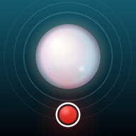
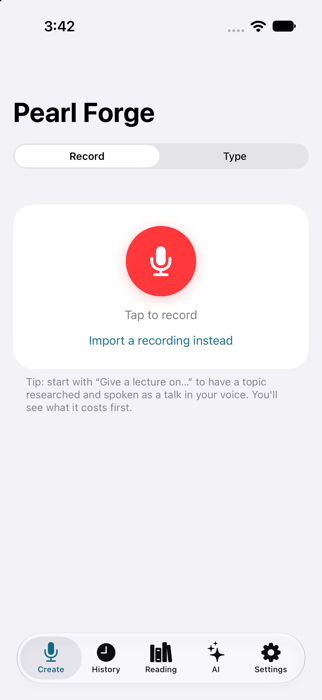
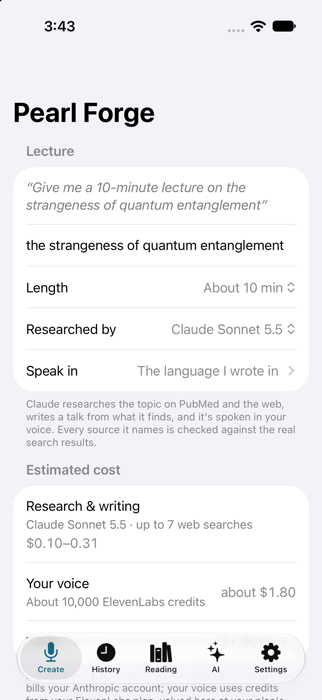
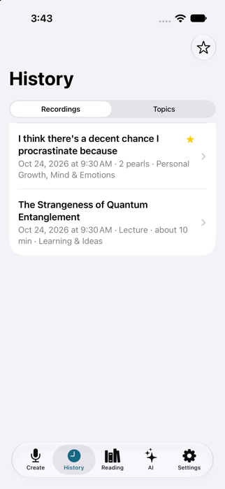
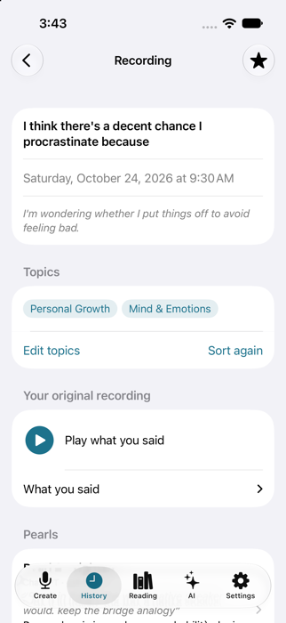

<p align="center">
  
</p>

<h1 align="center">Pearl Forge</h1>

<p align="center">
  Record a rough thought. Pearl Forge tidies the wording <b>without changing what you meant</b>,<br>
  then reads it back to you <b>in your own cloned voice</b>.
</p>

<p align="center">
  
  
  
  
</p>

---

## What it does

You talk the way you think: half-finished sentences, "um", tangents. Pearl Forge turns that into something you'd be happy to hear back, and keeps both.

- **Record or type.** Tap the red button and think out loud, or type something you want said.
- **Polish without rewriting you.** Choose **Clean** (a light tidy-up), **Tighten** (reorganised, nothing important lost) or **Summarize** (the core of it, still your view). The rules are strict: your hedges stay hedges, nothing is added that you didn't say, and it still sounds like you.
- **Hear it in your voice.** The result is spoken by your own [ElevenLabs](https://elevenlabs.io) voice clone.
- **Speak it in another language.** Pick one of 29 languages and hear yourself say it there.
- **Keep every version.** The untouched original recording is always kept. Each polished version is a "pearl"; forge as many as you like, with different modes or AIs, and compare.
- **Topics.** Recordings sort themselves into topics like *Relationships* or *Work & Career*. **Play all in order** plays everything you've said about one topic, back to back.
- **Find reading.** Pearl Forge searches PubMed and the web for research papers, essays and articles related to a thought. Every source is checked against the real search results, so a made-up title or link is never saved.
- **Lectures.** Say *"Give a 10-minute lecture on the strangeness of quantum entanglement."* Claude researches the topic, writes a talk, and you hear it in your voice. Before anything is spent you see what it will cost, and afterwards what it actually cost.
- **Choose the AI.** Claude is the default; ChatGPT, Gemini and OpenRouter work too, each with your own key.

## How it works

```
your voice note ──► ElevenLabs Scribe ──► Claude (or another AI) ──► ElevenLabs, in your voice ──► saved
                      transcript          polished, same meaning        audio
```

There are no accounts and no Pearl Forge servers. The app talks straight to the services you choose, with your own API keys, and you're billed by them directly.

## What a lecture costs

The lecture screen shows the estimate before you start. Typical costs with Claude Sonnet 5.5, on an ElevenLabs Creator plan:

| Length | Research and writing (Claude) | Your voice (ElevenLabs) | Total |
|---|---|---|---|
| 5 minutes | 7–21¢ | about 5,000 credits ≈ $0.90 | about $1 |
| 10 minutes | 10–30¢ | about 10,000 credits ≈ $1.80 | about $2 |
| 20 minutes | 15–46¢ | about 20,000 credits ≈ $3.60 | about $4 |

The voice is most of the cost. The Claude estimate starts as a range and narrows as it learns what your own lectures cost.

## Privacy

- API keys are entered once in the app and kept in the iPhone's Keychain, on that phone only. They're never in the code.
- Recordings stay on the iPhone, or in an iCloud Drive folder you choose.
- Audio and text go only to the services that do the work: ElevenLabs, your chosen AI, and PubMed for reading.

## Building it

You need a Mac with Xcode 27 and an iPhone on iOS 17 or later.

1. Open `PearlForge.xcodeproj`.
2. Under **Signing & Capabilities**, choose your own team. A free Apple ID works, but apps installed that way stop opening after 7 days until you install them again.
3. Run it on your iPhone.
4. In the app, add your ElevenLabs key (Settings) and your Claude key (AI tab).

You'll need an ElevenLabs account with a voice clone, and a Claude API key from [console.anthropic.com](https://console.anthropic.com).

## Other versions

- **Android:** [pearl-forge-android](https://github.com/SolidPlisskin/pearl-forge-android), built for tablets such as the Galaxy Tab S9.
- **Windows:** [`docs/PEARL_FORGE_WINDOWS_BUILD_GUIDE.md`](docs/PEARL_FORGE_WINDOWS_BUILD_GUIDE.md) has everything needed to build a portable `.exe`.

All three use the same recording format.

## Inside the code

| Folder | What's there |
|---|---|
| `PearlForge/Pipeline` | The cloud calls, the polishing prompts, research, lectures and cost estimates |
| `PearlForge/Recordings` | How recordings and pearls are saved |
| `PearlForge/Screens` | One file per screen (SwiftUI) |
| `PearlForge/Settings` | Keychain storage and the AI choices |
| `Design` | The script that draws the app icon |

Written in Swift and SwiftUI, with no third-party packages.

---

A personal project, built with [Claude Code](https://claude.com/claude-code). It's shared here so people can see it, but there's no open-source license yet, so please ask before reusing the code.
